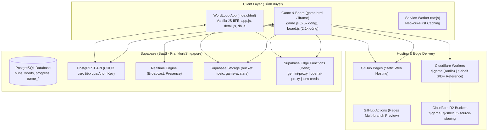
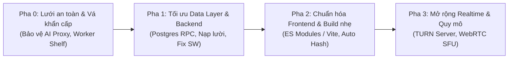

# BÁO CÁO AUDIT HẠ TẦNG & TƯ VẤN CẢI THIỆN (FRONTEND & BACKEND)

> **Dự án:** TJ WordLoop Hub (`W02-tj-wordloop-hub`)  
> **Worktree:** `C:\Users\User\Desktop\TJ\_work\wt-restructure-plan` (Nhánh: `feat/restructure-plan`)  
> **Thời điểm đánh giá:** 2026-10-20  
> **Loại tác vụ:** Audit & Technical Advisory (Bảo mật, hiệu năng, kiến trúc & lộ trình cải thiện)  

---

## I. TỔNG QUAN HỆ THỐNG VÀ BỐI CẢNH KIẾN TRÚC

TJ WordLoop Hub khởi đầu là một ứng dụng tĩnh web-first phục vụ tự học từ vựng tiếng Anh theo phương pháp lặp lại ngắt quãng (Spaced Repetition System - Tony Buzan) dành cho gia đình/nội bộ. Qua quá trình phát triển, hệ thống đã mở rộng thành một nền tảng học tập đa năng, bao gồm:
1. **WordLoop App (`index.html`):** Quản lý Hub / Notebook / Section / Page / Batch / Block, bài đọc tạo tự động bằng AI, flashcard, kiểm tra nghĩa, bài tập ngữ cảnh, theo dõi tiến trình Journey.
2. **Game & Bảng tương tác (`game.html` / `gamelayer.js`):** Phòng chơi tương tác nhiều người (Kahoot-like multiplayer), bảng vẽ cộng tác (whiteboard), chia sẻ màn hình, âm thanh WebRTC mesh, phụ đề nhận dạng giọng nói CC (Web Speech API).
3. **Bộ đề thi TOEIC / IELTS (`test_items`):** Kho dữ liệu 2.000+ câu hỏi ETS 2023/2024 có âm thanh, cắt ảnh, phân đoạn lời thoại Whisper và lời giải đa ngôn ngữ (vi, en, zh, es).
4. **Hệ thống tự học chuyên biệt (`learn/`):** EA Quest, Digital Marketing, IELTS Speaking/Writing.

### Sơ đồ kiến trúc hiện tại:



---

## II. AUDIT CHI TIẾT HẠ TẦNG & BẢO MẬT (INFRASTRUCTURE & SECURITY)

### 1. [MỨC ĐỘ NGUY HIỂM: CAO NHẤT] Rò rỉ chi phí API qua AI Proxy công khai
* **Tệp liên quan:** `supabase/functions/gemini-proxy/index.ts` và `supabase/functions/openai-proxy/index.ts`.
* **Hiện trạng cấu hình:**
  - Hai Edge Function được triển khai với cờ `--no-verify-jwt`.
  - Header CORS: `Access-Control-Allow-Origin: *`.
  - Cơ chế kiểm soát hạn mức (Quota Check) có điều kiện bypass ngầm:
    ```typescript
    if (!userId || !blockId || !SERVICE_ROLE_KEY || !SUPABASE_URL) return { blocked: false };
    ```
* **Rủi ro khai thác:**
  - Bất kỳ ai kiểm tra Network tab trên trình duyệt hoặc đọc `js/config.js` đều lấy được `SUPABASE_URL` và `SUPABASE_ANON_KEY`.
  - Khi gửi request `POST` trực tiếp đến `/functions/v1/openai-proxy` hoặc `/functions/v1/gemini-proxy` mà **bỏ trống trường `user_id`** (hoặc đặt `null`), proxy sẽ coi như không cần giới hạn quota và chuyển tiếp lệnh gọi thẳng tới OpenAI (GPT-4o) / Google Gemini.
  - Hậu quả: Nguy cơ cạn kiệt tài khoản OpenAI trả phí hoặc bị khóa tài khoản do abuse/spam.

---

### 2. [MỨC ĐỘ NGUY HIỂM: CAO] Cloudflare Worker `tj-shelf` mở toang quyền Ghi và Xóa
* **Tệp liên quan:** `tools/shelf-worker/worker.js`.
* **Hiện trạng cấu hình:**
  - Phương thức hỗ trợ: `GET, PUT, POST, DELETE, OPTIONS` cho mọi domain (`CORS *`).
  - Các route biến đổi dữ liệu:
    - `PUT /file/:key`: Cho phép ghi đè/tạo mới file.
    - `DELETE /file/:key`: Cho phép xóa file.
    - `POST /mkdir`: Tạo thư mục.
    - `POST /move`: Di chuyển/đổi tên file.
  - **Hoàn toàn không có Bearer token, password hay secret header bảo vệ.**
  - Mỗi request `PUT` chạy hàm `listAll(env, "", null)` quét toàn bộ bucket R2 để kiểm tra tổng dung lượng 2 GB.
* **Rủi ro khai thác:**
  - Người lạ có thể gửi request `DELETE /file/Books/...` để xóa sách tham khảo trên kệ.
  - Kẻ tấn công có thể spam các request `PUT` giả mạo để ép Worker thực hiện hàng nghìn thao tác `listAll`, làm cạn kiệt giới hạn 100.000 request/ngày của gói Cloudflare Worker Free và đốt quota Class A operations của R2.

---

### 3. [BẢO MẬT DỮ LIỆU] RLS PostgreSQL mở toàn quyền (`shared_all`) & Đăng nhập qua URL
* **Tệp liên quan:** `tools/supabase_schema.sql`, `tools/game_schema.sql`, `js/auth.js`.
* **Hiện trạng cấu hình:**
  - Nhằm tạo điều kiện đăng nhập tức thì không cần email (`?u=<uuid>`), các bảng trong database được gán policy:
    ```sql
    create policy shared_all on public.<table_name> for all to anon, authenticated using (true) with check (true);
    ```
  - Mọi ràng buộc phân quyền (ví dụ: chỉ Admin mới được tạo Block, chỉ Host TJ mới mở phòng game) chỉ nằm ở tầng hiển thị giao diện JavaScript (`Auth.isAdmin()`).
* **Hạn chế:**
  - Người dùng có kiến thức kỹ thuật có thể sử dụng PostgREST client kết hợp với `SUPABASE_ANON_KEY` công khai để chạy lệnh xóa (`DELETE`), cập nhật (`PATCH`) trên các bảng dữ liệu `words`, `blocks`, `game_answers` mà không bị chặn ở database layer.

---

### 4. Quản lý Database Migration thủ công & Lệch pha Schema
* **Hiện trạng:**
  - Việc cập nhật database trong lịch sử được thực hiện thủ công thông qua Supabase SQL Editor hoặc curl Management API bằng token PAT cá nhân.
  - Tệp `tools/supabase_schema.sql` trong repo không phản ánh đầy đủ cấu trúc DB thực tế (thiếu các cột `bookmarked`, `wrong_open`, `wrong_ctx`, `ref_word_ids`, `quiz_zh`, `quiz_es` đã được chạy trực tiếp trên production).
* **Hạn chế:** Khi cần dựng lại môi trường test hoặc khôi phục dữ liệu từ schema file, hệ thống sẽ gặp lỗi sai lệch schema (`column does not exist`).

---

## III. AUDIT CHI TIẾT FRONTEND & CLIENT PERFORMANCE

### 1. File mã nguồn quá khổ (Monolithic Files) & Ô nhiễm phạm vi toàn cục
* **Thống kê dung lượng mã nguồn:**
  - `js/game.js`: **5.561 dòng** (~528 KB) – Chứa ~390 hàm nội bộ trong một IIFE.
  - `js/app.js`: **4.947 dòng** (~301 KB) – Điều khiển toàn bộ màn hình chính.
  - `js/detail.js`: **3.081 dòng** (~177 KB) – Xử lý học tập, quiz, flashcard.
  - `js/board.js`: **2.137 dòng** (~214 KB) – Canvas vẽ, chia sẻ màn hình, PDF reader.
  - `css/app.css` (2.375 dòng) và `css/game.css` (2.108 dòng).
* **Vấn đề cấu trúc:**
  - Tồn tại mạng lưới phụ thuộc chéo thông qua `window.*` (`w.App`, `w.DB`, `w.Auth`, `w.Context`, `w.Board`, `w.Game`, `w.S`, `w.D`).
  - Trình duyệt di động phải phân tích cú pháp (parse/compile JS) hơn **2 MB code thô** ngay khi tải trang, gây tốn pin và giảm độ mượt (Jank/FPS drop).

---

### 2. Quản lý Cache thủ công (`?v=N`) & Lệch pha Service Worker
* **Vấn đề Cache-busting:**
  - Ứng dụng không sử dụng công cụ build (bundler) mà đánh phiên bản thủ công: `game.js?v=399`, `css/game.css?v=285`, `app.js?v=68`.
  - Rủi ro con người: Mỗi lần chỉnh sửa nếu quên tăng số `?v=` tương ứng ở `index.html` hoặc `game.html`, trình duyệt của người dùng và CDN GitHub Pages sẽ tiếp tục lưu cache file cũ, tạo ra lỗi "đã đẩy code nhưng người dùng vẫn thấy phiên bản cũ".
* **Lệch pha trong Service Worker (`sw.js`):**
  - Mảng `ASSETS` trong `sw.js` lưu đường dẫn tĩnh không có tham số phiên bản (`"./js/app.js"`), trong khi `index.html` yêu cầu `"./js/app.js?v=68"`.
  - Cache name cố định `"tjwl-v1"` không tự động dọn dẹp khi có cập nhật.
  - Các module của phòng game (`game.js`, `board.js`, `css/game.css`) chưa được đưa vào danh sách pre-cache của PWA.

---

### 3. Tải và xử lý dữ liệu nặng ở Client (Client-Side Aggregation)
* **Vị trí điển hình:** `js/db.js` (`distinctWordIndex` và `DB.getFullTree`).
* **Thực trạng:**
  - Hàm `distinctWordIndex()` tải toàn bộ danh sách từ vựng (~12.000 dòng) về trình duyệt thông qua nhiều vòng lặp phân trang 1.000 dòng, chỉ để đếm số từ khác nhau và chuẩn hóa chuỗi bằng JavaScript.
  - `DB.getFullTree` thực hiện truy vấn đồng thời quét toàn bộ bảng `hubs`, `notebooks`, `sections`, `pages`, `batches`, `blocks` thay vì tải lười (lazy-load) theo nhánh cây người dùng bấm mở.
* **Hậu quả:** Gây tắc nghẽn luồng xử lý chính (Main Thread Blocking) trên các thiết bị di động cấu hình trung bình/yếu và tiêu tốn băng thông mạng không cần thiết.

---

### 4. Giới hạn WebRTC Mesh trong Voice Phòng Game
* **Tệp liên quan:** `js/voice.js`.
* **Cơ chế:** Kết nối P2P dạng Full-Mesh không qua máy chủ trung gian ($N \times (N-1)$ kết nối).
* **Hạn chế:**
  - Chỉ hoạt động ổn định khi số lượng người bật mic dưới 6-8 người. Khi phòng học đông hơn (15-20 người), lượng băng thông upload của mỗi người nói và tải CPU giải mã audio sẽ tăng theo cấp số nhân.
  - Hệ thống hiện dựa hoàn toàn vào máy chủ STUN công khai của Google. Cấu hình Cloudflare TURN chưa được kích hoạt chính thức trong production, dẫn tới việc người dùng 4G/5G hoặc mạng doanh nghiệp có NAT nghiêm ngặt dễ bị chặn kết nối thoại.

---

## IV. AUDIT CHI TIẾT BACKEND & DATA PIPELINE

### 1. Thiếu hụt Stored Procedures (RPC) và Database Views
* Hầu hết logic nghiệp vụ phức tạp (chu kỳ SRS Tony Buzan, đếm từ duy nhất, tính điểm Leaderboard, gộp cây thư mục) đều do client-side JavaScript tính toán sau khi kéo dữ liệu thô từ PostgREST.
* Việc thiếu các PostgreSQL RPC function khiến số lượng round-trip mạng tăng cao, làm chậm tốc độ phản hồi trên đường truyền quốc tế (máy chủ Supabase đặt tại Singapore/Frankfurt kết nối về Việt Nam).

### 2. Sự phụ thuộc vào Cron Keepalive
* Tệp `.github/workflows/supabase-keepalive.yml` gửi truy vấn định kỳ mỗi 3 ngày để ngăn dự án Supabase Free-tier bị pause.
* Nếu GitHub Actions gặp sự cố mạng hoặc lỗi workflow chạy ngầm mà không có cơ chế cảnh báo, database có nguy cơ bị tạm dừng sau 7 ngày không hoạt động.

---

## V. LỘ TRÌNH ĐỀ XUẤT CẢI THIỆN (PHASED ROADMAP)

Để đảm bảo vừa giải quyết triệt để các rủi ro bảo mật và hiệu năng, vừa tôn trọng nguyên tắc **không làm gián đoạn trải nghiệm người dùng hiện tại**, lộ trình được đề xuất theo 4 giai đoạn:



---

### Pha 0: Lưới an toàn & Vá khẩn cấp (Ưu tiên P0 - Thực hiện ngay)
1. **Khóa bảo vệ AI Proxy (`gemini-proxy` & `openai-proxy`):**
   - Sửa logic kiểm tra: Bắt buộc request phải có `user_id` hợp lệ. Nếu thiếu hoặc không tìm thấy trong database, trả về ngay lập tức `HTTP 401 Unauthorized`.
   - Bổ sung kiểm tra Secret Header chia sẻ giữa client và Edge Function nhằm ngăn chặn việc gọi API trực tiếp từ bên ngoài bằng Postman/Curl.
2. **Bổ sung khóa xác thực cho Worker `tj-shelf`:**
   - Yêu cầu header xác thực bí mật (ví dụ: `X-Shelf-Token`) đối với các phương thức `PUT`, `DELETE`, `POST`.
   - Loại bỏ thao tác `listAll` quét toàn bộ bucket trên mỗi lượt tải file; quản lý dung lượng qua metadata.
3. **Đồng bộ hóa file Migration Database:**
   - Cập nhật lại `tools/supabase_schema.sql` khớp 100% với các cột và chỉ mục thực tế trên production.

---

### Pha 1: Tối ưu Data Layer & Truy vấn Backend (Ưu tiên P1)
1. **Chuyển các tác vụ thống kê nặng về PostgreSQL RPC:**
   - Tạo function `get_hub_stats(p_user_id)` trực tiếp trong PostgreSQL để tính số từ duy nhất và số từ đã thuộc. Client chỉ cần gọi qua RPC và nhận về 1 object JSON nhỏ gọn thay vì tải 12.000 dòng từ vựng về máy.
   - Áp dụng kỹ thuật nạp lười (Lazy-loading) cho cây thư mục Journey/Sidebar: chỉ tải cấp Hub/Notebook lúc đầu, nạp Section/Page/Block khi người dùng nhấn mở.
2. **Khắc phục lệch pha Service Worker (`sw.js`):**
   - Đưa cấu hình `ignoreSearch: true` vào `caches.match()` để các file có query string phiên bản (`?v=N`) vẫn được nhận diện chính xác từ bộ nhớ đệm khi mất mạng.
   - Bổ sung các tài nguyên game (`game.js`, `board.js`, `css/game.css`) vào danh mục lưu trữ ngoại tuyến của PWA.

---

### Pha 2: Hiện đại hóa Frontend & Tự động hóa Build (Ưu tiên P2)
1. **Chuyển dịch sang ES Modules và Vite (Zero-config Bundler):**
   - **Tự động gắn Content Hash:** File xuất xưởng có định dạng `app.[hash].js`, chấm dứt hoàn toàn việc phải tăng số `?v=...` thủ công và loại bỏ triệt để lỗi người dùng bị kẹt cache cũ.
   - **Phân tách mã nguồn (Code Splitting):** Chia tách file `game.js` (5.500 dòng) và `app.js` (4.900 dòng) thành các module chức năng độc lập theo đúng định hướng tại `PLAN_RESTRUCTURE.md`.
   - Tích hợp lệnh `npm run build` vào GitHub Actions (`pages-preview.yml`), giữ nguyên khả năng xem trước theo nhánh (Preview per branch).
2. **Thiết lập kiểm tra chất lượng tự động (CI Quality Gates):**
   - Thêm bước kiểm tra cú pháp (`node --check`) và rà soát file trong CI trước khi cho phép merge vào `main`.

---

### Pha 3: Nâng cấp Năng lực Realtime & Mở rộng Phòng Game (Ưu tiên P3)
1. **Triển khai chính thức Cloudflare TURN Server:**
   - Cấu hình thông tin xác thực TURN thông qua Edge Function `turn-creds` để đảm bảo 100% người dùng trên mạng di động 4G/5G hoặc mạng Wi-Fi công ty có thể tham gia thoại trong game mà không bị chặn.
2. **Lộ trình nâng cấp âm thanh đa người dùng:**
   - Khi các phòng học vượt quá quy mô 15 người cùng tham gia, chuyển dịch mô hình thoại từ WebRTC Full-Mesh sang Selective Forwarding Unit (SFU) như Cloudflare Calls hoặc LiveKit Cloud (có gói Free 50GB/tháng) để đảm bảo chất lượng âm thanh ổn định và tiết kiệm tài nguyên máy người dùng.

---

## VI. BẢNG MA TRẬN ĐÁNH ĐỔI (TRADE-OFF MATRIX)

| Hạng mục | Trạng thái hiện tại | Giải pháp đề xuất | Chi phí / Đánh đổi | Lợi ích thu được |
|---|---|---|---|---|
| **Bảo vệ AI Proxy** | Bỏ qua kiểm tra nếu thiếu user_id | Bắt buộc `user_id` + Secret Token | ~1 giờ chỉnh sửa Edge Function | Ngăn chặn 100% nguy cơ cạn kiệt số dư OpenAI và lạm dụng API |
| **Worker Shelf** | Mở toang PUT / DELETE | Thêm header xác thực `X-Shelf-Token` | Cập nhật script upload của Agent | Bảo vệ an toàn dữ liệu sách trên R2, tránh spam quota |
| **Cache-busting** | Tăng tay `?v=N` (đã tới v399) | Tự động hóa bằng Bundler (Vite) | Thêm bước build trong GitHub Actions | Triệt tiêu hoàn toàn lỗi stale-cache người dùng, tách module rõ ràng |
| **Thống kê từ vựng** | Kéo 12.000 từ về duyệt JS | Viết PostgreSQL RPC Function | Viết 1 script SQL trên Supabase | Giảm 95% payload tải trang, loại bỏ hiện tượng đơ lag trên mobile |
| **Voice trong Game** | Mesh WebRTC + STUN công khai | Kích hoạt Cloudflare TURN credentials | Cấu hình Token Cloudflare vào Secret | Đảm bảo kết nối thoại thành công 100% trên mạng 4G/5G và công ty |

---
*Báo cáo được lập để lưu trữ và theo dõi tiến trình tái cấu trúc codebase tại worktree `feat/restructure-plan`.*
