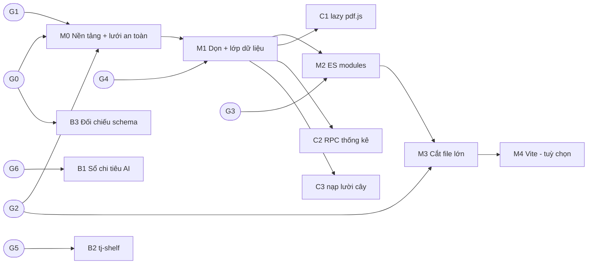

# ROADMAP_RESTRUCTURE — lộ trình thực hiện restructure

> Trạng thái: **DỰ THẢO, CHƯA DUYỆT, CHƯA BẮT ĐẦU.** Sinh từ `PLAN_RESTRUCTURE.md` bản 2.1. Đặc tả đích ở `SPEC_RESTRUCTURE.md`; danh mục test ở `TEST_REGRESSION_RESTRUCTURE.md`.
> Ước lượng tính bằng "phiên làm việc" (một phiên Claude Code/một buổi), thô, chưa kiểm chứng. Không có ngày lịch vì còn phụ thuộc các quyết định của TJ.

## 1. Nguyên tắc vận hành lộ trình

1. **Mỗi cột mốc có cổng vào và cổng ra.** Chưa qua cổng vào thì không bắt đầu; chưa qua cổng ra thì không sang cột mốc sau.
2. **Không bước nào vừa đổi cấu trúc vừa đổi hành vi.** Muốn đổi hành vi thì tách luồng B hoặc C với PR riêng.
3. **Test trước, di chuyển sau.** Mỗi vùng mã chỉ được dời sau khi test đặc trưng (characterization) cho vùng đó đã xanh trên mã hiện tại.
4. **PR nhỏ, dễ hoàn tác.** Tham chiếu: một PR đụng một module hoặc một lớp, dưới ~600 dòng diff không tính phần chỉ dời nguyên văn. Mỗi PR có thể `git revert` độc lập.
5. **Quy ước repo giữ nguyên:** mỗi việc một nhánh `feat/…`/`fix/…`; TJ xem bản preview rồi mới lên `main`; `git push origin main` luôn là một lệnh riêng; bump `?v=N` (hoặc cơ chế thay thế sau A2) đúng file đã sửa; không commit đề ETS; không dán key.
6. **Luồng B (vá bảo mật) tách khỏi nhánh restructure** vì deploy nằm ngoài git và cần secret của TJ.
7. Mọi bước chạm dữ liệu Supabase chỉ THÊM (bảng/cột/hàm); chạy SQL **trước** khi merge code dùng nó và chỉ khi TJ đồng ý (`CLAUDE.md`).

## 2. Cổng quyết định của TJ (chặn việc gì)

| Cổng | Câu hỏi (plan, mục 9) | Chặn |
|---|---|---|
| G0 | 1, 2: chấp nhận A0; đóng băng tính năng hay không; một nhánh hay nhiều | Mọi thứ |
| G1 | 8: baseline (`git rebase main` cục bộ hay push rồi rebase `origin/main`) | M0 |
| G2 | 7: `handoff/gate` giữ và merge trước, hay hoãn | M0 (CI) và M3 (cắt `game.js`) |
| G3 | 3: cơ chế version (import map / đóng dấu / Vite) và thiết bị iOS đích | M2 |
| G4 | 4: vị trí `tools/` | M1 |
| G5 | 5: phương án xác thực `tj-shelf` | B2 |
| G6 | 6: trần chi tiêu AI, fail-closed/open, tính Gemini hay không | B1 |

Cổng nào chưa mở thì việc chặn bởi nó đứng yên; việc không bị chặn vẫn chạy.

## 3. Sơ đồ phụ thuộc

B1, B2, B3 không phụ thuộc M0–M3 và có thể chạy song song ngay khi cổng của chúng mở.

## 4. Cột mốc

### M0 — Nền tảng và lưới an toàn

**Cổng vào:** G0, G1, G2 đã mở.

| Việc | Đầu ra | Ghi chú |
|---|---|---|
| M0.1 Tích hợp baseline | Nhánh trên SHA baseline đã chốt; SHA ghi vào bảng số liệu gốc | |
| M0.2 Đo số liệu gốc | Bảng plan mục 7 điền đủ cột "Hiện tại" | gồm danh sách hàm `App.*` bị gọi ngược (SPEC §4.2) |
| M0.3 Test Node | Bộ test `context`, `srs`, `util`, `readalong`, adapter local `db`; kiểm tĩnh | TEST §3, §4.1 |
| M0.4 Khung Playwright | Mock REST/Storage/Functions, Realtime giả bằng `BroadcastChannel`, cố định dữ liệu/đồng hồ/random | TEST §12 |
| M0.5 Nhật ký lời gọi chuẩn | Golden call log cho mọi kịch bản chuẩn | TEST §5 |
| M0.6 Ảnh chuẩn | Ma trận màn × viewport; chạy hai lần giống hệt | TEST §6 |
| M0.7 Kịch bản hai client | Các kịch bản multiplayer chạy xanh trên mã hiện tại | TEST §7 |
| M0.8 CI | Workflow chạy test tầng PHẢI-chặn-merge; tích hợp test của `handoff/gate` nếu G2 giữ nó | TEST §11 |

**Cổng ra:** mọi test M0 xanh **trên mã chưa đổi**; ảnh chuẩn ổn định qua hai lần chạy; ma trận truy vết (TEST §10) không còn dòng "chưa có test" cho nhóm PHẢI-chặn-merge; TJ xem báo cáo số liệu gốc.
**Rủi ro:** mock lệch Realtime thật (giảm bằng kiểm tay hai thiết bị ở cổng ra M1/M3); bộ test chuẩn dao động (không tiếp tục nếu hai lần chạy khác nhau).
**Ước lượng:** 3–4 phiên (lớn hơn con số 1–2 phiên ở plan bản 1, vì bản 2.1 thêm mock Realtime, nhật ký lời gọi và hai client).

### M1 — Dọn và lớp dữ liệu

**Cổng vào:** M0 đã qua cổng ra; G4 mở nếu có việc dời `tools/`.

| Việc | Đầu ra |
|---|---|
| M1.1 `core/util` | `esc`, `shuffle`, `fmt`, `norm` còn 1 định nghĩa; các bản sao xoá |
| M1.2 `core/storage` | Mọi `localStorage` đi qua một chỗ, giữ nguyên khoá (I3) |
| M1.3 `data/` cho `auth`, `app`, `board` | 8 điểm Supabase ngoài `data/` còn lại về 0 |
| M1.4 `data/game` | 119 điểm của `game.js` về `data/game`, theo từng nhóm chức năng (phòng, đáp án, lịch sử, thư viện/kệ, tệp tạm) — mỗi nhóm một PR |
| M1.5 Client AI duy nhất | Một chỗ gọi Edge Function AI (hiện lặp 5 nơi), body không đổi |
| M1.6 `sw.js` | ASSETS khớp file thật |
| M1.7 Tài liệu | Tách kiến trúc / quyết định / backlog / runbook; `HANDOFF.md` giữ vai tạm thời |
| M1.8 `tools/` | Dời theo G4 (đề xuất repo riêng); không kéo theo lịch sử đề ETS vào repo công khai |

**Cổng ra:** nhật ký lời gọi khớp chuẩn sau mỗi PR M1.3–M1.5; ảnh sai khác = 0; kiểm tay hai thiết bị thật trong `ZZ_…` (lobby → ván → kết thúc, bảng, tải lại giữa ván) sau khi xong M1.4; số điểm Supabase/`localStorage` ngoài lớp quy định = 0.
**Rủi ro:** `game.js` có 119 điểm nên dễ sót; biện pháp là nhật ký lời gọi chuẩn chứ không phải đọc code. Dời `tools/` có thể làm gãy đường dẫn trong `CLAUDE.md`, `/qa`, `.claude/commands` — liệt kê và sửa cùng PR.
**Ước lượng:** 3–4 phiên.

### M2 — ES modules gốc

**Cổng vào:** M1 xong; **G3 đã chọn cơ chế version** (không bắt đầu chuyển module đầu tiên khi chưa chọn).

| Việc | Đầu ra |
|---|---|
| M2.1 Cơ chế version | Import map / script đóng dấu / (nếu G3 chọn Vite thì chuyển sang M4 trước) |
| M2.2 `/bump` bắc cầu | `.claude/commands/bump.md` cập nhật; kiểm một URL/module |
| M2.3 Chuyển theo thứ tự lá trước | `util` → `srs` → `context` → `speech` → `db` → `auth` → feature → `app`; mỗi lô một PR, giữ `window.X` tương thích |
| M2.4 Kiểm SW/offline | Tải online → offline → tải lại `index.html` và game |
| M2.5 CI đồ thị import | Không vòng; mỗi module đúng một mục version; đếm dòng tương thích giảm |

**Cổng ra:** I1–I8 (SPEC §2) vẫn đúng; kiểm offline đạt; kiểm "không kẹt cache" bằng cách đổi version một module lá và xác nhận mọi importer lấy bản mới (trên bản preview, có xoá cache và không xoá cache).
**Rủi ro:** module nhân đôi do URL khác nhau; iOS cũ không chạy import map; thứ tự khởi tạo thay đổi khi bỏ nạp tuần tự bằng thẻ `<script>`.
**Ước lượng:** 3–5 phiên.

### M3 — Cắt file lớn

**Cổng vào:** M2 xong; G2 đã giải quyết (nhánh `handoff/gate` đã vào `main` hoặc đã bị bỏ) để không xung đột trên `js/game.js`.

Thứ tự đề xuất (rủi ro tăng dần, vì phần sau bám nhiều phụ thuộc hơn):
1. `board.js` (phần canvas/chia sẻ/PDF tách thành module riêng).
2. `detail.js` theo tab: dictation → progress → meaning → single → sheet → quiz → study.
3. `app.js` theo màn hình: home/journey/wordset → danh sách Block → cây Notebook → dán/trích từ.
4. `game.js`: tách plugin (`voice`, `chat`, `cc`, `readalong`, `shadow`, `swclass` đã là file riêng — chỉ dọn giao diện với lõi) → state/room-net → rounds → UI.
5. CSS tách theo component, kèm bước ảnh chụp sau mỗi lần cắt.

**Cổng ra:** file lớn nhất dưới ~800 dòng (hoặc ngoại lệ có lý do); I1–I8; kiểm tay hai thiết bị thật sau mỗi lô thuộc `game.js`; bảng chỉ số plan mục 7 đạt đích.
**Rủi ro:** `game.js` có 390 hàm trong một phạm vi (chia sẻ biến đóng); cần lập đồ thị biến dùng chung trước khi cắt (đầu ra của M0.2). Mỗi lô cắt kèm test hai client.
**Ước lượng:** 5–8 phiên.

### M4 — Vite (tuỳ chọn)

**Cổng vào:** TJ chọn ở G3, hoặc lỗi cache vẫn tái diễn sau M2/M3. (Nếu G3 chọn Vite thay cho import map, M4 được kéo lên trước M2.)
**Đầu ra:** build có băm tên file, deploy bằng GitHub Actions, bản preview theo nhánh vẫn hoạt động (`pages-preview.yml`), local `python3 -m http.server` vẫn dùng được cho bản không build hoặc có hướng dẫn mới.
**Cổng ra:** không còn `?v=N` thủ công; offline/SW đạt; thời gian build CI ≤ 5 phút.
**Ước lượng:** 1–2 phiên (chưa tính chuyển deploy).

## 5. Luồng B — vá bảo mật (song song, nhánh `fix/…` riêng)

| Mã | Việc | Cổng vào | Cổng ra |
|---|---|---|---|
| B1 | Sổ chi tiêu AI: bảng `ai_spend_ledger`, hàm `reserve/settle`, danh sách model, trần kích thước và token, fail-closed, mã dùng chung `_shared/` | G6 + TJ đồng ý chạy SQL | 8 test của TEST §9.1 xanh, 4 đường gọi hợp lệ còn chạy; deploy bằng lệnh trong `CLAUDE.md` |
| B2 | `tj-shelf`: bỏ `listAll` mỗi PUT; xác thực theo phương án G5 | G5 | Test TEST §9.3; giới hạn 2 GB/25 MB giữ nguyên |
| B3 | Đối chiếu `supabase_schema.sql`/`game_schema.sql` với `information_schema` (chỉ đọc) | TJ cấp PAT tạm, nhắc thu hồi sau | Báo cáo lệch + sửa file cho khớp; không DDL |

Ước lượng: B1 1–2 phiên, B2 dưới 1, B3 dưới 1. Chưa deploy gì khi cổng chưa mở.

## 6. Luồng C — tối ưu dữ liệu (sau M1)

| Mã | Việc | Cổng vào | Cổng ra |
|---|---|---|---|
| C1 | Lazy-load pdf.js | M1 | Upload PDF vẫn đọc được; thông báo lỗi cũ giữ; JS nạp ở `index.html` giảm |
| C2 | RPC `total_words` + `mastered` | M1; TJ đồng ý chạy SQL | TEST §9.2: so cũ/mới bằng nhau với mọi user trên dữ liệu thật; đường cũ giữ sau cờ một phiên |
| C3 | Nạp lười cây (`getFullTree`) | M1, C2 | Chỉ làm nếu C2 chưa đủ; test Journey + ảnh chụp |

Ước lượng: C1 dưới 1, C2 1–2, C3 1–2. Đo thời gian trước/sau trên mạng giả lập chậm.

## 7. Quy trình mỗi PR (danh sách kiểm)

Mỗi PR restructure PHẢI đạt trước khi báo xong:

1. Nhánh `feat/…` từ baseline hiện tại; `git fetch` và `git rev-list --left-right --count origin/main...HEAD` trước khi đẩy (máy khác cũng đẩy).
2. `node --check` mọi file đã sửa, nối bằng `&&`; dừng nếu lỗi.
3. Test Node + kiểm tĩnh xanh.
4. Playwright: nhóm PHẢI-chặn-merge xanh; ảnh sai khác = 0; nhật ký lời gọi khớp chuẩn (khác thì liệt kê từng dòng khác và lý do để TJ duyệt).
5. `/bump` (bản bắc cầu sau M2); `GAME_VER` khớp `game-version.json`; `starter` khớp version.
6. `/verify` cho vùng `context.js` nếu có đụng.
7. Sửa một chỗ thì rà các chỗ giống (`grep`) và sửa cùng lượt (quy ước TJ 2026-10-08).
8. Agent QA độc lập cho PR đụng `game.js`/`board.js` hoặc giao thức realtime (quy ước đã dùng 3 vòng cho thay đổi tương tự).
9. Bản preview của nhánh; TJ xem; chỉ khi TJ bảo mới `git push origin main` (một lệnh riêng) và kiểm workflow "pages build and deployment".
10. Cập nhật bảng trạng thái ở mục 8 trong cùng PR.

## 8. Bảng theo dõi tiến độ

| Cột mốc | Trạng thái | Cổng đang chờ | Ghi chú |
|---|---|---|---|
| G0–G6 | Chưa mở | TJ trả lời plan mục 9 | |
| M0 | Chưa bắt đầu | G0, G1, G2 | |
| M1 | Chưa bắt đầu | M0, G4 | |
| M2 | Chưa bắt đầu | M1, G3 | |
| M3 | Chưa bắt đầu | M2, G2 | |
| M4 | Tuỳ chọn | G3 | |
| B1 | Chưa bắt đầu | G6 | |
| B2 | Chưa bắt đầu | G5 | |
| B3 | Chưa bắt đầu | TJ cấp PAT | |
| C1–C3 | Chưa bắt đầu | M1 | |

## 9. Thứ tự đề xuất nếu phải ưu tiên

1. **Ngay (song song, không phụ thuộc):** B1 (chi phí AI bị hở), B3 (chỉ đọc).
2. **M0** (nền cho mọi thứ còn lại).
3. **M1**, trong lúc đó chạy **C1**.
4. **C2** (hiệu năng Journey) khi M1 xong.
5. **M2 → M3**.
6. **M4** và **C3** chỉ khi còn cần.

## 10. Tổng ước lượng và điều kiện thay đổi lộ trình

| Phần | Phiên |
|---|---|
| M0 | 3–4 |
| M1 | 3–4 |
| M2 | 3–5 |
| M3 | 5–8 |
| M4 (tuỳ chọn) | 1–2 |
| B1–B3 | 2–4 |
| C1–C3 | 2–5 |
| **Luồng A (M0–M3)** | **14–21** |

Con số lớn hơn plan bản 1 (11–18) vì M0 nay gồm Supabase/Realtime giả và kịch bản hai client. Lộ trình PHẢI được xét lại nếu: (a) hai lần chạy ảnh chuẩn không giống nhau mà không che được vùng dao động; (b) nhật ký lời gọi chuẩn cho thấy `game.js` có nhiều điểm gọi động (chuỗi bảng ghép lúc chạy) hơn dự tính; (c) TJ không đóng băng tính năng và xung đột trên các file lớn vượt khả năng rebase thường xuyên; (d) thiết bị iOS đích không hỗ trợ import map.
