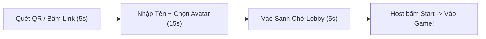
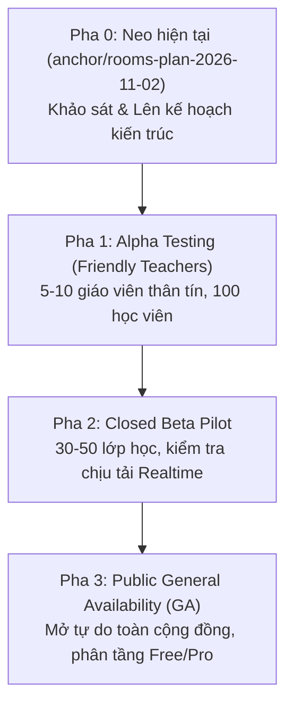

# 02_PRODUCT_UX_AND_ROLLOUT — Thiết Kế Trải Nghiệm Người Dùng (UX), Phân Quyền & Lộ Trình Triển Khai Mở Phòng Game TJ

> **Mã tài liệu:** `DOCS-ROOMS-02`  
> **Tác giả:** AGY (Sản phẩm / UX / Chi phí)  
> **Dự án:** TJ WordLoop & Rooms Platform  
> **Neo kiểm soát:** Tag `anchor/rooms-plan-2026-11-02` trên `W02_TJHUB` (main: `8d9b2fe`)  
> **Trạng thái:** DỰ THẢO NGHIÊN CỨU & KẾ HOẠCH (KHÔNG SỬA MÃ, KHÔNG ĐỘNG DB)  
> **Ngày lập:** 2026-11-02  
> **Nguyên tắc:** Thảo đang đi đường không trả lời câu hỏi — AGY tự chọn phương án an toàn nhất, ghi rõ giả định, tương thích ngược 100% với phòng TJ hiện tại.

---

## 0. Các giả định tự chọn thay Thảo (Design Assumptions)

1. **Giả định 1 (Phòng TJ là bất khả xâm phạm):** Mọi tài khoản, mã phòng `TJ`, profile ID `f3fd95c9-06e8-4d39-b6f2-efc113d436cf` (`js/game.js:55`) và luồng chơi cố định của TJ được bảo vệ ở tầng ưu tiên cao nhất. Thiết kế cho người dùng ngoài là lớp mở rộng (additive), không ghi đè hành vi cũ.
2. **Giả định 2 (Không rào cản cho người chơi - Zero-Friction Player):** Người chơi (học sinh, bạn bè) **không cần đăng ký/đăng nhập tài khoản**. Chỉ cần quét QR hoặc bấm link, nhập nickname trong 10 giây là vào chơi.
3. **Giả định 3 (Host phải được định danh):** Người mở phòng (Host) **phải có tài khoản** (đăng nhập Google qua Supabase Auth hoặc liên kết profile WordLoop) để chịu trách nhiệm về phòng, quản lý nội dung và khống chế hạn mức chi phí.
4. **Giả định 4 (Hạ tầng tiết kiệm tối đa):** Tận dụng tối đa tài nguyên miễn phí sẵn có (Cloudflare R2 Egress $0, Web Speech API trình duyệt $0 cho TTS), không ép Thảo hay TJ phải trả tiền AI API cho người lạ. Người dùng ngoài muốn dùng AI nâng cao phải dùng gói trả phí hoặc tự điền API key của họ (BYO Key).

---

## 1. Chân dung người dùng ngoài (User Personas)

Khi mở nền tảng phòng game WordLoop ra ngoài phạm vi nội bộ TJ, hệ thống phục vụ 4 nhóm đối tượng chính với nhu cầu và hành vi hoàn toàn khác nhau:

| Tiêu chí | 👩‍🏫 Nhóm 1: Giáo viên độc lập | 🏢 Nhóm 2: Trung tâm ngoại ngữ | 👥 Nhóm 3: Nhóm bạn học tập | 👤 Nhóm 4: Người tự học (Solo) |
|---|---|---|---|---|
| **Mục đích chính** | Ôn bài đầu giờ, khởi động, kiểm tra từ vựng/nghe cuối buổi học. | Chuẩn hóa giáo trình, tổ chức thi đấu định kỳ giữa các lớp. | Chơi game giải trí tốc độ cao, thách đấu từ vựng, vừa chơi vừa gọi thoại. | Luyện phản xạ từ vựng, tự kiểm tra phát âm/nghe theo chu trình Tony Buzan. |
| **Quy mô phòng** | 10 – 30 học viên / phòng. | 30 – 100 học viên / phòng (chia nhiều lớp hoặc thi đấu toàn trung tâm). | 3 – 8 người / phòng. | 1 người (solo mode). |
| **Tần suất dùng** | 2 – 4 buổi / tuần; 15 – 30 phút / buổi. | Liên tục theo ca học hàng ngày (8h – 21h). | Ngẫu hứng, cuối tuần, tối muộn (1 – 2 giờ/lần). | Hàng ngày, 10 – 20 phút mỗi sáng/tối. |
| **Nhu cầu nội dung** | Thích chọn nhanh bài theo giáo trình TOEIC/IELTS có sẵn; muốn nạp danh sách từ riêng của bài hôm đó. | Cần bộ đề đóng gói riêng của trung tâm (chống lộ đề ra ngoài), gắn logo/thương hiệu trung tâm. | Dùng 100% kho đề chung vui nhộn (Slang, TOEIC vui, CIA 1000 câu giao tiếp). | Dùng kho từ vựng cá nhân đang học dở trên WordLoop Notebook. |
| **Thiết bị sử dụng** | Host dùng Laptop/Máy tính bảng; học sinh dùng điện thoại (iOS/Android). | Host dùng PC lớp học kết nối máy chiếu/TV; học viên dùng điện thoại/laptop cá nhân. | 100% điện thoại thông minh, vừa mở game vừa bật app voice (HelloTalk/Discord). | Điện thoại hoặc Laptop cá nhân. |
| **Điểm nhạy cảm nhất** | Học sinh vào phòng phải nhanh (không bắt tạo tài khoản), mạng chập chờn không bị văng. | Bảo mật danh sách học viên, không bị người lạ vào phá phòng, quản lý được giáo viên. | Vào game ngay lập tức, bảng xếp hạng realtime, animation vui mắt. | Lưu được lịch sử đúng/sai bền vững, đồng bộ tiến trình học SRS. |

---

## 2. Luồng trải nghiệm người dùng (UX User Journey)

### 2.1. Luồng Host (Tạo phòng & Điều khiển ván)
1. **Truy cập & Đăng nhập Host:** Truy cập `game.html` -> Chọn "Mở phòng học" -> Đăng nhập bằng Google / WordLoop Profile (nếu chưa đăng nhập).
2. **Cấu hình phòng (Lobby Config):**
   - **Tên phòng / Lớp:** Nhập tên gợi nhớ (vd: *Lớp TOEIC Thầy Nam K45*).
   - **Mã phòng:** Hệ thống cấp mã 5 ký tự ngẫu nhiên (vd: `KT89M`) hoặc giữ **Mã phòng cố định** cho tài khoản Pro (vd: `THAYNAM`).
   - **Chọn phạm vi kiến thức (Scope):** Chọn từ Thư viện chung (TOEIC Test 1-10, Barron 600, Digital Marketing, EA 2025) HOẶC nạp bộ từ riêng của giáo viên.
   - **Chọn thể thức ván đấu:**
     - *Dạng câu (qtype):* Nghĩa (`meaning`), Điền từ (`gap`), Gõ từ (`recall`), Đề thi TOEIC (`toeic`), Ghép câu (`order`), hoặc Trộn (`mix`) (`js/game.js:21-27`).
     - *Chế độ (mode):* Cùng làm câu (`kahoot`) hoặc Tự do theo tốc độ (`free`) (`js/game.js:19`).
     - *Chia đội (team_mode):* Cá nhân hoặc 2–4 đội (`team_red`, `team_blue`, `team_green`, `team_yellow`) (`js/game.js:26`, `tools/game_schema.sql:22`).
     - *Thời gian:* Đặt số phút hoặc tự động tính theo số từ (`autoCount` tại `js/game.js:1116`).
3. **Mời học viên:** Host bấm "Copy link mời" (link dạng `game.html?room=KT89M`) hoặc bấm "Màn hình chung" để phóng to **Mã phòng + Mã QR Code** lên máy chiếu.
4. **Vào trận & Điều khiển:** Khi thấy học viên vào sảnh (hiển thị danh sách Realtime qua Supabase Presence), Host bấm **"Bắt đầu ván đấu"**. Trong trận, Host có quyền sang câu tiếp, tạm dừng, hiện đáp án sớm hoặc kết thúc ván.

### 2.2. Luồng Người chơi / Học viên (Player Flow — Cam kết Onboarding dưới 60 giây)
Hệ thống thiết kế theo nguyên lý **Zero-Friction**:

- **Bước 1 (0 – 10 giây):** Học viên quét mã QR từ máy chiếu hoặc bấm vào link giáo viên gửi qua Zalo/Telegram. URL tự nạp tham số `?room=KT89M`.
- **Bước 2 (10 – 30 giây):** Màn hình chào mừng xuất hiện:
  - Nếu trình duyệt đã chơi trước đó: Hệ thống tự điền tên và avatar cũ đã lưu trong `localStorage` (`tjwl_game_player`), chỉ cần bấm **"Vào ngay"** (1 chạm).
  - Nếu là người mới: Gõ Nickname (vd: "Mai Anh"), chọn nhanh 1 emoji đại diện có sẵn (hoặc upload ảnh đại diện tối đa 300 KB lên bucket `game-avatars` theo `tools/game_schema.sql:71`).
  - Xử lý trùng tên: Tự động đánh số `#2`, `#3` phía sau (`js/game.js:10`, `tools/game_schema.sql:8`), học viên không bao giờ bị báo lỗi "tên đã tồn tại" gây nghẽn lớp học.
- **Bước 3 (30 – 45 giây):** Chọn ngôn ngữ mẹ đẻ (`meaning_lang`): Tiếng Việt, English, Español, 中文 để hệ thống hiển thị nghĩa phù hợp (`js/game.js:28`).
- **Bước 4 (45 – 60 giây):** Ngồi trong sảnh chờ nhìn thấy tên mình xuất hiện trên màn hình máy chiếu của Host. Sẵn sàng nhận câu hỏi đầu tiên.

### 2.3. Luồng Màn hình chung (Screen View — Chế độ máy chiếu / TV)
- Mở link với tham số `?room=KT89M&view=screen` (`js/game.js:1707`).
- Giao diện loại bỏ hoàn toàn các nút trả lời cá nhân, chỉ hiển thị:
  - Đồng hồ đếm ngược ván đấu to rõ.
  - Nội dung câu hỏi và các phương án A, B, C, D với màu sắc nhận diện tương ứng.
  - Bảng biểu đồ trực tiếp số người đã trả lời theo từng phương án (Realtime polling chart).
  - Bảng xếp hạng Top 5 và điểm số các đội bóng nhảy múa sinh động sau mỗi câu.
- **Tiết kiệm tài nguyên:** Màn hình Screen chỉ lắng nghe broadcast `state`, không gửi `ans`, không chiếm quota người chơi hoạt động.

---

## 3. Ma trận vai trò người dùng (Roles & Permissions Matrix)

Để hệ thống vận hành an toàn khi mở công khai, phân quyền được chuẩn hóa thành 5 vai trò rõ rệt:

| Hành động / Quyền hạn | 👑 Owner (Chủ trường/Cơ sở) | 👨‍🏫 Host (Giáo viên phụ trách) | 🧑‍💼 Co-host (Trợ giảng / Lớp phó) | 🎮 Player (Học viên) | 📺 Viewer / Screen (Máy chiếu) |
|---|:---:|:---:|:---:|:---:|:---:|
| **Tạo phòng mới & Đặt tên phòng** | ✅ | ✅ | ❌ | ❌ | ❌ |
| **Sở hữu mã phòng cố định (VIP)** | ✅ | ✅ (nếu gói Pro) | ❌ | ❌ | ❌ |
| **Chọn đề / Thay đổi cấu hình ván** | ✅ | ✅ | ✅ (được ủy quyền) | ❌ | ❌ |
| **Bấm "Bắt đầu" / "Kết thúc ván"** | ✅ | ✅ | ✅ | ❌ | ❌ |
| **Kích người chơi / Khóa sảnh (Kick/Lock)** | ✅ | ✅ | ✅ | ❌ | ❌ |
| **Chấm bài viết / Tra từ điển AI** | ✅ | ✅ | ✅ | ❌ (chỉ gửi bài) | ❌ |
| **Tải lên tài liệu riêng vào Kệ Bảng** | ✅ | ✅ | ❌ | ❌ | ❌ |
| **Trả lời câu hỏi & Ghi nhận điểm số** | ❌ (đang host) | ❌ (đang host) | ❌ | ✅ | ❌ |
| **Xem lại bài làm cá nhân & Lịch sử ván** | ✅ | ✅ | ✅ | ✅ (chỉ xem của mình) | ❌ |
| **Đổi đội / Tự đổi avatar, tên hiển thị** | ✅ | ✅ | ✅ | ✅ | ❌ |
| **Xóa vĩnh viễn phòng & Lịch sử điểm** | ✅ | ❌ (chỉ xóa ván) | ❌ | ❌ | ❌ |

---

## 4. Nội dung riêng vs. Thư viện chung (Custom Content vs. Core Library)

Hệ thống xử lý phân tách 2 nguồn nội dung rõ ràng để đảm bảo tính riêng tư và bảo vệ bản quyền:

```
┌────────────────────────────────────────────────────────────────────────┐
│                        KHO NỘI DUNG ROOMS PLATFORM                     │
├───────────────────────────────────┬────────────────────────────────────┤
│   📚 THƯ VIỆN CHUNG (Core Shared)  │   🔒 BỘ ĐỀ RIÊNG (Custom Content)   │
│   (Mọi phòng đều được dùng)        │   (Chỉ chủ phòng & học sinh dùng) │
├───────────────────────────────────┼────────────────────────────────────┤
│ • TOEIC ETS 2024 / 2023 (2.000 câu│ • Danh sách từ vựng do GV nạp:     │
│   trắc nghiệm + giải thích chi tiết)│   - Nhập từ vựng kèm nghĩa Excel/CSV│
│ • Barron 600 Essential Words      │   - Gắn từ các Notebooks cá nhân   │
│ • Digital Marketing Vocab          │ • Bài đọc riêng của trung tâm/lớp  │
│ • EA 2025 (Enrolled Agent Part I) │ • Đề thi nội bộ bảo mật            │
│ • CIA 1000 Chunks & Collocations  │ • Ảnh minh họa riêng tải lên bucket│
│                                   │   `lib/_tmp/<room_code>/`          │
├───────────────────────────────────┼────────────────────────────────────┤
│ Lưu trữ: Supabase DB + Cloudflare │ Lưu trữ: Supabase DB phân tách theo│
│ R2 `tj-game` (Audio mp3 $0 egress)│ `owner_id` + Row Level Security (RLS)│
│ Quyền: CHỈ ĐỌC (Public Read)      │ Quyền: CHỦ SỞ HỮU TOÀN QUYỀN       │
└───────────────────────────────────┴────────────────────────────────────┘
```

- **Quy tắc cô lập dữ liệu (Data Isolation):**
  - Các bảng chứa kho đề chung (`test_items`, `game_gap_sentences`, `notebooks` hệ thống) cấp quyền SELECT công khai cho mọi client (`tools/game_schema.sql:65`, `tools/game_gap_schema.sql:16`).
  - Các bộ đề riêng của giáo viên được lưu trữ với cột `owner_id` (tham chiếu `auth.users.id`). RLS chỉ cho phép Host sở hữu phòng truy vấn và người chơi đang kết nối vào phòng có chứa `scope` đó đọc dữ liệu trong thời gian ván đấu diễn ra.

---

## 5. Quản trị phòng, Kiểm duyệt & Onboarding 60 giây

### 5.1. Công cụ Quản trị phòng thời gian thực (Realtime Moderation)
Nhằm ngăn chặn tình trạng quấy rối lớp học khi phòng mở công khai trên Internet:
1. **Kick Player (Đuổi người phá rối):** Host bấm vào tên người chơi trong danh sách Lobby/Roster -> Chọn "Đuổi khỏi phòng". Hệ thống gửi broadcast lệnh `kick` kèm `player_id`. Trình duyệt học sinh đó bị ngắt kênh Realtime và điều hướng về trang chủ `game.html` kèm thông báo bị trục xuất.
2. **Lock Room (Khóa sảnh):** Khi lớp học đã vào đủ quân số, Host gạt công tắc "Khóa phòng". Khi sảnh bị khóa, bất kỳ ai nhập mã phòng sau đó đều nhận thông báo "Phòng đã bắt đầu và đang khóa, vui lòng liên hệ giáo viên".
3. **Censor Tên bậy (Profanity Filter):** Hệ thống tích hợp bộ lọc từ khóa phản cảm (tiếng Việt & tiếng Anh) ngay tại client khi học viên nhập tên (`name_ph` tại `js/game.js:109`). Nếu tên chứa từ cấm, hệ thống tự động thay thế bằng Nickname dễ thương dạng `Học viên vui vẻ #X` hoặc `Panda #Y`.
4. **Anti-Spam Answer Submissions:** Chặn học sinh bấm nút đáp án liên tục làm nghẽn kênh Realtime. Sau mỗi lần bấm chọn đáp án, nút bấm bị vô hiệu hóa (disabled) trong 500ms (`debounce`), chống flood broadcast `ans`.

### 5.2. Trải nghiệm khi Host rớt mạng & Cơ chế chuyển giao Host (Host Interruption & Failover UX)
Trong thiết kế hiện tại, Host là nguồn sự thật duy nhất (`js/game.js:16`). Nhằm bảo đảm lớp học không bị vỡ trận khi giáo viên gặp sự cố kết nối:
1. **Cảnh báo trực quan tức thì (`#p-hostlost`):**
   - Nếu Host không gửi nhịp tim trong `HOST_LOST_MS = 7000` (7 giây theo `js/game.js:103`), client học viên lập tức hiện thanh thông báo vàng ở đầu màn hình: `host_lost: "⚠ Host mất kết nối — chờ host quay lại…"` (`game.html:175`, `js/game.js:110`).
   - Ở chế độ làm bài tự do (`mode: free`), hệ thống hiển thị: `host_lost_free: "⚠ Host mất kết nối — bạn cứ làm tiếp, đáp án sẽ tự gửi khi host quay lại"` (`js/game.js:110`). Học sinh tiếp tục làm bài độc lập, đáp án được lưu tạm trong bộ nhớ trình duyệt client.
2. **Cơ chế dự phòng tiếp sóng ngang hàng (Peer Relay):**
   - Khi Host vắng mặt quá 3 giây, client trong phòng tự động phát tán bản sao trạng thái gần nhất (`relay: 1` tại `js/game.js:1745`) để người mới vào sau không bị trắng màn hình.
3. **Cửa sổ chờ phục hồi 30 giây (Grace Period Reconnect):**
   - Host tải lại trang (reload) hoặc chuyển mạng (wifi sang 4G) sẽ được khôi phục toàn bộ trạng thái ván đấu từ `localStorage` (`LS_HOST = "tjwl_game_host_" + MÃ` tại `js/game.js:147`), không bị mất điểm số của học sinh.
4. **Lộ trình chuyển giao Host (Host Failover / Co-host Handover ở Pha 2 & 3):**
   - *Pha 1 (Alpha):* Áp dụng cửa sổ chờ 30s; nếu Host không quay lại sau 60s, phòng chuyển sang chế độ tự do xem lại kết quả đã nộp.
   - *Pha 2-3 (Beta & GA):* Nếu phòng có chỉ định Co-host (Trợ giảng), quyền điều khiển Host được tự động chuyển giao cho Co-host sau 45s Host chính ngắt kết nối; điểm số tiếp tục được ghi nhận bình thường.
5. **Xử lý học viên tải lại trang hoặc thiết bị tắt màn hình (Mobile Sleep & Tab Reconnect):**
   - Khi học viên tắt màn hình hoặc chuyển sang ứng dụng khác (Zalo, gọi điện), trình duyệt trên điện thoại tự ngắt kết nối WebSocket Realtime nhằm tiết kiệm pin.
   - Khi mở lại trình duyệt, client tự động gửi broadcast `join` kèm `player_id` cũ được lưu bền vững trong `localStorage` (`tjwl_game_player` tại `js/game.js:147`).
   - Host nhận sự kiện `join`, nhận diện lại `player_id`, đối chiếu bảng điểm hiện tại `G.st.scores` (`js/game.js:1754`), giữ nguyên toàn bộ điểm số cũ và gửi ngay gói trạng thái `state` mới nhất về client. Học viên tiếp tục ván đấu ngay lập tức mà không bị reset điểm hay bị văng khỏi lớp.

---

## 6. An toàn, Riêng tư & Tuân thủ COPPA / GDPR (Mức tóm tắt)

Khi mở cho các lớp học trẻ em và học sinh sinh viên, sản phẩm tuân thủ nghiêm ngặt các nguyên tắc bảo vệ quyền riêng tư:

### 6.1. Tuân thủ COPPA (Children's Online Privacy Protection Act - Trẻ dưới 13 tuổi)
- **Không thu thập dữ liệu định danh cá nhân (PII):** Hệ thống tuyệt đối không yêu cầu người chơi cung cấp: Tên thật, Họ, Địa chỉ nhà, Trường học, Số điện thoại, Email, hay Vị trí địa lý GPS.
- **Không bắt buộc ảnh thật:** Avatar mặc định là emoji sinh vật hoạt hình. Nếu tải ảnh lên, dung lượng giới hạn tối đa 300 KB (`tools/game_schema.sql:71`) và được lưu dưới dạng UUID ngẫu nhiên không gắn với bất kỳ thông tin cá nhân nào.
- **Không có tính năng Chat tự do giữa người chơi:** Tránh nguy cơ quấy rối trẻ em hoặc gửi nội dung độc hại. Giao tiếp trong phòng chỉ qua câu trả lời trắc nghiệm, các nút reaction emoji định sẵn và hệ thống chấm điểm tự động.

### 6.2. Tuân thủ GDPR (General Data Protection Regulation - Tóm tắt)
- **Nguyên tắc giảm thiểu dữ liệu (Data Minimization):** Dữ liệu ván đấu (`game_results`, `game_answers`) chỉ lưu trữ: `player_id` (UUID ẩn danh), điểm số, thời gian làm bài mili-giây (`tools/game_schema.sql:55`).
- **Quyền được quên (Right to be Forgotten):** 
  - Toàn bộ câu trả lời chi tiết từng câu (`game_answers`) tự động xoá theo chu kỳ sau 30 ngày qua cron job dọn dẹp để bảo vệ dung lượng DB và xóa vết dữ liệu.
  - Người dùng có thể xóa sạch lịch sử chơi trên máy mình bất kỳ lúc nào bằng nút "Xóa lịch sử trên máy này" (`localStorage.removeItem`).

---

## 7. Đề xuất phân tầng gói dịch vụ Free vs. Pro (Dựa trên số liệu tài liệu 03)

Dựa trên các giới hạn kỹ thuật đo lường được của Supabase (200 CCU Free, 500 CCU Pro) và chi phí vận hành AI (tài liệu 03), bảng hạn mức sản phẩm được thiết kế tối ưu hóa chi phí:

| Tính năng & Hạn mức | 🎁 Gói Miễn Phí (Free Community) | 💎 Gói Chuyên Nghiệp (Pro Teacher / School) |
|---|---|---|
| **Đối tượng** | Học sinh tự học, nhóm bạn, giáo viên dạy kèm nhỏ (dưới 15 người). | Giáo viên trường, trung tâm Anh ngữ, lớp học đông (20 – 100 học viên). |
| **Giá cước đề xuất** | **0 VNĐ / Mãi mãi** | **199.000 VNĐ / tháng** (~8 USD) hoặc 1.800.000 VNĐ / năm |
| **Số phòng đồng thời** | Tối đa **1 phòng** / tài khoản host. | Tối đa **5 phòng** đồng thời / tài khoản. |
| **Sĩ số người chơi tối đa** | **15 người chơi** / phòng (chặn đứng trước trần 200 CCU của Supabase). | **60 người chơi** / phòng (có thể mở rộng 100 người). |
| **Mã phòng** | Mã ngẫu nhiên 5 ký tự (hết hạn sau 24h không dùng). | **Mã phòng cố định thương hiệu** (vd: `IELTSHUONG`, `THAYTUNG`). |
| **Kho thư viện bài học** | Toàn quyền dùng Kho thư viện chung (TOEIC, Barron, EA, DM). | Dùng kho chung + **Tải lên bộ từ vựng & bài đọc riêng không giới hạn**. |
| **Chấm bài viết Speaking & Writing bằng AI** | Tối đa **3 bài / ngày** (dùng chung hạn mức `ai_usage_daily` hiện tại của WordLoop). | **Không giới hạn** (hoặc tích hợp tính năng **BYO Key** tự điền API Key cá nhân). |
| **Lưu trữ Bảng & Tài liệu** | Tối đa 5 file tạm / buổi (tự dọn sau 7 ngày). | Lưu trữ vĩnh viễn tới **2 GB** trên Kệ R2 cá nhân. |
| **Xuất báo cáo kết quả** | Xem trực tiếp trên web sau ván. | **Xuất file Excel (.xlsx) bảng điểm chi tiết** từng học viên và phân tích câu sai. |

---

## 8. Bộ chỉ số thành công của sản phẩm (Success Metrics)

Hệ thống theo dõi các chỉ số đo lường trải nghiệm (UX) và hiệu năng kỹ thuật:

| Nhóm chỉ số | Tên chỉ số | Mục tiêu đo lường (Target) | Phương pháp đo lường |
|---|---|---|---|
| **Onboarding Friction** | Time-to-First-Answer (TTFA) | **< 60 giây** | Đo từ timestamp mở trang lần đầu đến lúc gửi broadcast `ans` câu số 1. |
| **Độ ổn định kết nối** | Disconnect Rate | **< 1.5%** tổng lượt chơi | Số lần kích hoạt sự kiện `host_lost` hoặc reconnect Realtime thất bại (`js/game.js:110`). |
| **Mức độ gắn kết** | Matches per Session | **≥ 3.2 ván** / buổi học | Trung bình số bản ghi `game_matches` được tạo trên 1 `room_id` trong 1 buổi. |
| **Tỷ lệ hoàn thành** | Completion Rate | **≥ 88%** học viên | Tỷ lệ người chơi ở lại từ câu số 1 đến màn hình công bố kết quả chung cuộc. |
| **Hiệu quả tài nguyên** | AI Cache Hit Rate | **≥ 75%** lượt tra từ / gap | Tỷ lệ câu hỏi điền từ hoặc tra từ vựng lấy từ cache/DB có sẵn thay vì gọi proxy mới. |

---

## 9. Lộ trình triển khai thử nghiệm (Rollout Roadmap có ANCHOR)

Lộ trình được chia làm 4 pha chặt chẽ, mỗi pha đều có **Mục tiêu**, **Cổng nghiệm thu định lượng**, và **Phương án hoàn tác an toàn (Rollback Plan)**:



### Pha 0: Khảo sát & Lập Kế hoạch (Hiện tại)
- **Neo (Anchor):** Tag Git `anchor/rooms-plan-2026-11-02` trên commit `8d9b2fe`.
- **Mục tiêu:** Hoàn thiện bộ 3 tài liệu nghiên cứu kiến trúc (`01`), sản phẩm UX (`02`), và mô hình chi phí (`03`). Tuyệt đối không chạm vào mã nguồn và cơ sở dữ liệu.
- **Cổng nghiệm thu:** Cả 3 tài liệu được kiểm chéo (Cross-review) giữa Codex và AGY đạt trạng thái `ACCEPT`.
- **Cách hoàn tác:** Xóa worktree nhánh `docs/rooms-public-plan`, repo gốc `W02_TJHUB` hoàn toàn nguyên vẹn.

### Pha 1: Thử nghiệm Bạn bè & Giáo viên thân tín (Alpha Friendly - 4 tuần)
- **Mục tiêu:** Kiểm chứng luồng tạo phòng cho người ngoài với 5 – 10 giáo viên quen của TJ; tối đa 100 học viên cùng tham gia.
- **Phạm vi kỹ thuật:**
  - Giữ nguyên 1 project Supabase hiện tại. Thêm cột `host_profile_id` thay vì ép cứng `f3fd95c9-06e8-4d39-b6f2-efc113d436cf` (`js/game.js:55`).
  - Áp dụng trần cứng: Tối đa 20 người/phòng.
  - Sử dụng 100% kho đề trắc nghiệm chung có sẵn (chưa mở upload file riêng).
- **Cổng nghiệm thu đo lường được:**
  1. 100% giáo viên tạo được phòng và bắt đầu ván đấu mà không cần TJ can thiệp kỹ thuật.
  2. Thời gian vào phòng trung bình của học viên đạt `< 45 giây`.
  3. Không có sự cố giật màn hình hoặc cướp quyền host giữa các tab (`js/game.js:1696`).
  4. Chi phí Supabase Realtime giữ nguyên ở mức gói Free ($0).
- **Cách hoàn tác:** Đổi biến cờ tính năng `ALLOW_EXTERNAL_HOST = false` trong `js/config.js`; hệ thống lập tức quay về cơ chế chỉ cho phép profile của TJ làm host (`isTJ()`).

### Pha 2: Thử nghiệm Giới hạn (Closed Beta Pilot - 6 tuần)
- **Mục tiêu:** Mở rộng cho 30 – 50 lớp học tại các trung tâm đối tác; kiểm tra khả năng chịu tải Realtime đồng thời (peak 150 – 200 CCU).
- **Phạm vi kỹ thuật:**
  - Nâng cấp Supabase lên gói **Pro ($25/tháng)** có bật Spend Cap.
  - Kích hoạt tính năng **BYO API Key** cho giáo viên muốn dùng AI chấm bài Writing/Speaking không giới hạn.
  - Bổ sung bảng quản trị phân quyền RLS nhiều tầng (Multi-tenant RLS).
  - Triển khai cơ chế Shared AI Cache cho mọi câu hỏi điền từ và từ điển.
- **Cổng nghiệm thu đo lường được:**
  1. Tỷ lệ disconnect dưới 1.5% trong các khung giờ cao điểm lớp học (19h – 21h).
  2. Chi phí AI do hệ thống TJ chi trả không vượt quá 10 USD / tháng (nhờ cơ chế cache và BYO key).
  3. Bảng xếp hạng và kết quả ván đấu lưu trữ chính xác 100% không bị mất điểm khi host tải lại trang.
- **Cách hoàn tác:** Tắt cờ Beta, chuyển đổi các phòng ngoài về chế độ chỉ đọc kết quả cũ, bảo toàn nguyên vẹn phòng của TJ.

### Pha 3: Mở Công Khai Toàn Diện (Public GA - Multi-tenant Self-Serve)
- **Mục tiêu:** Mở cổng đăng ký tự do cho cộng đồng giáo viên và người học trên toàn quốc; vận hành mô hình Freemium tự bù đắp chi phí (Self-sustaining).
- **Cổng nghiệm thu đo lường được:**
  1. Đạt tối thiểu 200 phòng hoạt động thường xuyên hàng tuần.
  2. Doanh thu từ các gói Pro bù đắp tối thiểu 200% chi phí hạ tầng Supabase Pro ($25) + Egress + Proxy AI.
  3. Hệ thống giám sát tự động (`infra_report.py`) cảnh báo trước khi tài nguyên chạm 80% ngưỡng định mức.

---

## 10. Ma trận đối chiếu 3 Phương án Kiến trúc kỹ thuật & Lộ trình Pha (Architectural Alignment Matrix)

Nhằm bảo đảm sản phẩm và trải nghiệm người dùng gắn kết chặt chẽ với hạ tầng kỹ thuật, 3 phương án kiến trúc được đánh giá toàn diện theo 4 câu hỏi của Thảo trong ANCHOR_ROOMS:

| Tiêu chí so sánh | 🏛️ Phương án A: 1 Supabase Project + Multi-tenant RLS | 🏢 Phương án B: Cô lập Supabase Project theo Tenant | ⚡ Phương án C: Host-ủy-quyền Gọn nhẹ / BYO Key |
|---|---|---|---|
| **Mô tả giải pháp** | Dùng chung 1 dự án Supabase hiện tại; bổ sung cột `tenant_id` / `host_profile_id` và viết lại toàn bộ chính sách Row Level Security (RLS). | Mỗi trường học / trung tâm được cấp 1 project Supabase độc lập (hoặc schema riêng biệt). | Game chạy ở chế độ Stateless; Host đóng vai trò game server cục bộ; dùng Realtime Broadcast thuần; AI dùng key riêng của Host. |
| **Chi phí hạ tầng** | **Thấp nhất:** $0 ở Pha 1 (Free), $25/tháng ở Pha 2 (Pro) cho toàn hệ thống. | **Cao:** Mỗi đối tác tốn $25/tháng gói Pro; chi phí tăng tuyến tính theo số trường. | **Gần bằng $0:** Không tốn tiền DB; chi phí AI do từng Host tự trả qua key riêng. |
| **Bảo vệ phòng TJ** | **Rất an toàn:** Giữ nguyên schema gốc của TJ, thêm điều kiện RLS bảo vệ phòng code `"TJ"`. | **Tuyệt đối an toàn:** Phòng TJ nằm trên project riêng biệt, người ngoài không thể chạm tới. | **Tuyệt đối an toàn:** Người ngoài không ghi dữ liệu vào DB chung của TJ. |
| **Độ phức tạp triển khai** | Vừa phải: Cần audit kỹ lưỡng RLS policies để không hở dữ liệu giữa các phòng. | Cao: Phải viết script tự động hóa khởi tạo project (provisioning) và di chuyển schema. | Thấp: Không cần sửa DB; chỉ cần nâng cấp logic client và thêm ô nhập BYO Key. |
| **Khả năng hoàn tác (Rollback)** | Rất dễ: Chỉ cần rollback các migration RLS và tắt cờ `ALLOW_EXTERNAL_HOST`. | Phức tạp: Phải gỡ bỏ kết nối project và chuyển dữ liệu người dùng. | Cực kỳ dễ: Tắt cờ tính năng client là xong. |
| **Khuyến nghị & Pha áp dụng** | **KHUYẾN NGHỊ LÕI (Pha 1 & Pha 2):** Phù hợp với cộng đồng vừa và nhỏ, tối ưu ngân sách. | **Dự phòng mở rộng (Pha 3):** Chỉ áp dụng khi có hợp đồng B2B lớn từ các trung tâm ngoại ngữ. | **TÍNH NĂNG ĐI KÈM (Pha 1 -> 3):** Áp dụng ngay cho nhóm bạn tự học và giáo viên tự quản lý key. |

---

## 11. Bản phác thảo giao diện ASCII kích thước chuẩn 390px (Mobile Portrait)

Dưới đây là 2 màn hình quan trọng nhất được thiết kế chuẩn xác theo chiều rộng màn hình điện thoại thông dụng (390px CSS / 39 cột văn bản ASCII):

### 11.1. Màn hình Tạo phòng & Cấu hình ván đấu (Host View — 390px)
```
+-------------------------------------+
| [<-]  TJ WORDLOOP - TAO PHONG   [X] |
+-------------------------------------+
| Ten phong: [ Lop TOEIC Thay Nam   ] |
| Ma phong : [ THAYNAM ] (Co dinh *)  |
+-------------------------------------+
| 1. CHON PHAM VI BAI HOC (SCOPE)     |
| [*] Thu vien chung:                 |
|     (•) TOEIC ETS 2024 - Test 03    |
|     ( ) Barron 600 Essential Words  |
|     ( ) Tieng Anh Giao Tiep CIA     |
| [ ] Bo tu rieng cua toi (3 danh muc)|
+-------------------------------------+
| 2. CAU HINH THE THUC VAN DAU        |
| Dang cau:                           |
| [ Nghia (A/B/C/D) ] [ Dien tu (Gap)]|
| [*TOEIC 4 dap an  ] [ Che do Tron  ]|
|                                     |
| Che do choi:                        |
| [*] Cung lam (Kahoot) [ ] Tu do     |
|                                     |
| Chia doi:                           |
| (•) Ca nhan   ( ) 2 Doi   ( ) 4 Doi |
|                                     |
| Thoi gian:                          |
| [ 15s / cau ]     Tong: 20 cau (5p) |
+-------------------------------------+
| 3. NANG CAO (AI & AM THANH)         |
| [X] Tu dong doc tieng Anh (TTS Web) |
| [ ] Cham bai viet bang AI (BYO Key) |
+-------------------------------------+
|  [=== LUU CAU HINH & MO PHONG ===]  |
+-------------------------------------+
```

### 11.2. Màn hình Sảnh chờ đa năng (Lobby / Player & Host View — 390px)
```
+-------------------------------------+
| TJ ROOM: KT89M        [🔊 Bat] [🌐VI] |
+-------------------------------------+
|        QUET QR DE VAO PHONG         |
|        +-----------------+          |
|        |  █▀▀▀█ █ █ █▀▀▀█|          |
|        |  █ ▀ █ █▀█ █ ▀ █|          |
|        |  ▀▀▀▀▀ ▀ ▀ ▀▀▀▀▀|  390px   |
|        |  ██ ▀█▀▀██ █▀▀██|  Mobile  |
|        |  █▀▀▀█ ▀█  █ ▀ █|  Screen  |
|        |  ▀▀▀▀▀ ▀▀▀ ▀▀▀▀▀|          |
|        +-----------------+          |
|       game.html?room=KT89M          |
|    [ Sao chep link ] [ Phong to ]   |
+-------------------------------------+
| CHU DE: TOEIC ETS 2024 - Test 03    |
| THE THUC: Kahoot • 15s/cau • 20 cau |
+-------------------------------------+
| DANH SACH NGUOI CHOI (14 da vao)   |
| 1. 🦊 Minh Tuan       2. 🐼 Lan Anh |
| 3. 🐯 Hoang Nam #1    4. 🐰 Hoang #2|
| 5. 🐱 Mai Huong       6. 🦁 Duc Huy |
| 7. 🐸 Thao Nguyen     8. 🐨 Bao Anh |
| ... va 6 nguoi khac                 |
+-------------------------------------+
| [KHOA SANH: TAT]       [DOI: CA NHAN]|
+-------------------------------------+
| >>> [ BAT DAU VAN DAU (HOST) ] <<<  |
|     (Hoc vien: "Cho host bat dau")  |
+-------------------------------------+
```

### 11.3. Màn hình Màn hình chung Máy chiếu / TV (Screen View — Chế độ 16:9 Projector Mode)
```
+-----------------------------------------------------------------------+
|  TJ WORDLOOP - PHONG: KT89M  [=== THE THUC: KAHOOT ===]  [⏰ CON: 08s] |
+-----------------------------------------------------------------------+
| CAU 04 / 20: Choose the correct word to complete the sentence:        |
|                                                                       |
| "The marketing team submitted the annual _______ before the deadline."|
+-----------------------------------+-----------------------------------+
| [A] proposal                      | [B] propose                       |
|     (📊 62% - 18 ban chon)        |     (📊  7% -  2 ban chon)        |
+-----------------------------------+-----------------------------------+
| [C] proposing                     | [D] proposed                      |
|     (📊 10% -  3 ban chon)        |     (📊 21% -  6 ban chon)        |
+-----------------------------------+-----------------------------------+
| BANG XEP HANG TOP 5 (29/29 da tra loi):                               |
| 1. 🦊 Minh Tuan (3.420d)   2. 🐼 Lan Anh (3.150d)  3. 🐯 Hoang Nam (2.980d)|
| 4. 🐱 Mai Huong (2.840d)   5. 🦁 Duc Huy (2.710d)                      |
+-----------------------------------------------------------------------+
| Quet QR de vao choi: [ █▀█ █ █▀█ ] game.html?room=KT89M&view=screen   |
+-----------------------------------------------------------------------+
```

---
*Tài liệu được lập bởi AGY theo đúng yêu cầu trong `prompts/S1_agy.md` và tuân thủ tuyệt đối các điều cấm trong `ANCHOR_ROOMS.md`.*
